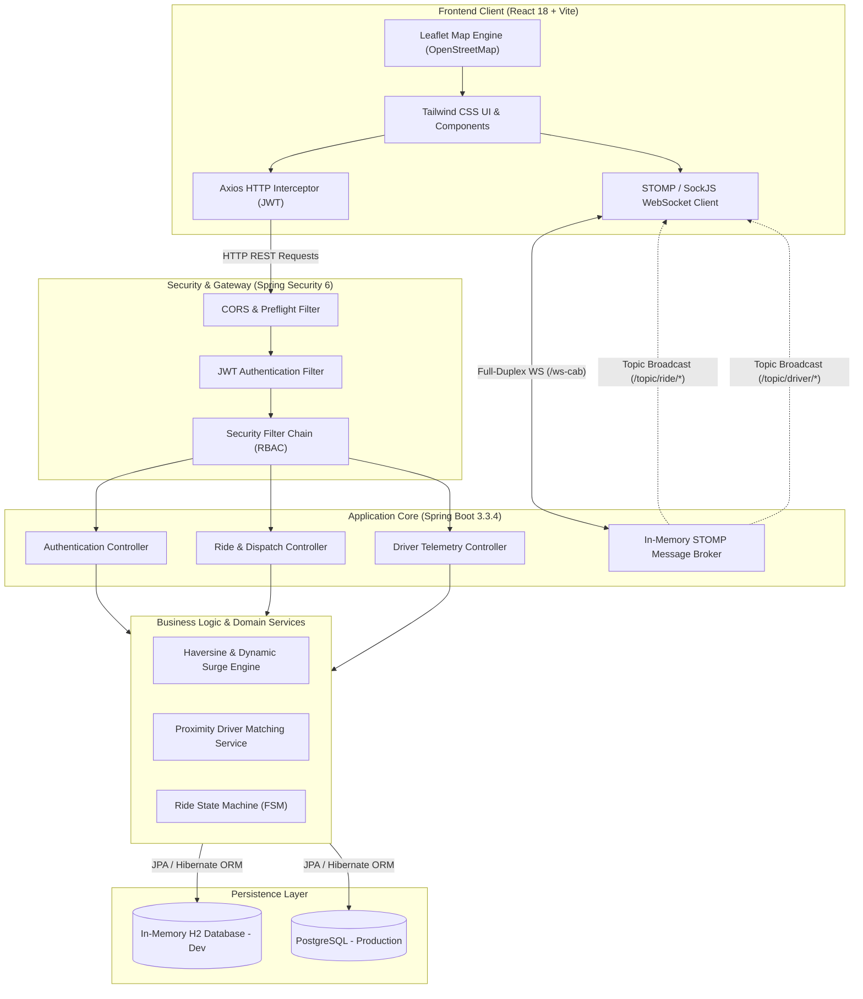

# Vayro — Enterprise Ride-Hailing Platform
## Comprehensive Technical Documentation & Presentation Guide

> **Live Production URL:** [https://vayro-frontend.onrender.com/](https://vayro-frontend.onrender.com/)  
> **Source Repository:** [https://github.com/piyushFunde/Vayro](https://github.com/piyushFunde/Vayro)  
> **Stack:** Spring Boot 3.3.4 (Java 17) • React 18 (Vite) • WebSocket STOMP • Leaflet • PostgreSQL / H2  

---

## 1. Executive Summary

**Vayro** is an enterprise-grade, full-stack ride-hailing and fleet dispatch platform engineered to handle real-time geospatial tracking, dynamic trip pricing, driver dispatching, and secure multi-role user workflows.

### Key Objectives
* **Sub-second Dispatch Latency:** Bi-directional event communication using WebSocket STOMP protocol.
* **Geospatial Precision:** Accurate route geometry, turn-by-turn simulation, and distance computations using the Haversine formula.
* **Modern Reactive UX:** Production-grade responsive interface with dark/light map rendering, floating HUDs, and real-time state synchronization.
* **Cloud-Native Deployment:** Fully automated continuous deployment pipeline orchestrated on Render.

---

## 2. System Architecture



---

## 3. Core Frontend Architecture & Key Files

The frontend is structured under `frontend/src/` with clear separation of concerns:

```
frontend/src/
├── components/
│   ├── MapView.jsx              # Geospatial map engine with Leaflet & OSM
│   ├── RideBookingModal.jsx     # Multi-step ride booking wizard
│   ├── RideCategories.jsx       # Vehicle tier selection & pricing breakdown
│   ├── VayroHero.jsx            # Dynamic landing hero & action triggers
│   ├── ActiveRidePanel.jsx      # Live trip HUD with ETA & driver tracking
│   ├── DriverDashboard.jsx      # Real-time driver dispatch reception screen
│   ├── AdminDashboard.jsx       # Fleet & user management overview
│   └── AuthModal.jsx            # JWT Login & Registration modal
├── services/
│   ├── api.js                   # Central Axios client with dynamic base URL
│   └── websocket.js             # STOMP / SockJS client singleton
├── App.jsx                      # Global root orchestrator & state manager
└── index.css                    # Tailwind tokens & dark map CSS filters
```

### Deep Dive into Key Frontend Files

#### 1. `MapView.jsx`
* **Purpose:** Handles map rendering, GPS pin plotting, route polyline visualization, and driver vehicle tracking.
* **Key Implementation:**
  * Uses `react-leaflet` connected to standard OpenStreetMap tiles (`https://{s}.tile.openstreetmap.org/{z}/{x}/{y}.png`).
  * Implements zero-dependency dark mode through `.vayro-dark-map .leaflet-tile-pane` CSS filter without requiring paid tile services or API keys.
  * Dynamically rotates the driver vehicle icon based on heading degrees with CSS smooth transforms.
  * Custom HUD controls: Light/Dark toggle, Recenter map to route bounds, and Zoom In/Out.

#### 2. `websocket.js`
* **Purpose:** Manages full-duplex WebSocket connections with the Spring Boot backend.
* **Key Implementation:**
  * Uses `@stomp/stompjs` with `SockJS` fallback for environments blocking pure WebSockets.
  * Subscribes to `/topic/driver/{driverId}` for instant driver ride offers.
  * Subscribes to `/topic/ride/{rideId}` for real-time ride status transitions and driver GPS coordinates.
  * Automatic reconnection with exponential backoff.

#### 3. `api.js`
* **Purpose:** Centralized REST client.
* **Key Implementation:**
  * Auto-discovers backend URL dynamically from `VITE_API_BASE_URL` or `localStorage` override.
  * Automatic request interceptor injecting `Authorization: Bearer <token>`.
  * Encapsulates all 17 REST endpoints for clean component imports.

#### 4. `App.jsx`
* **Purpose:** Root application state orchestrator.
* **Key Implementation:**
  * Coordinates active ride states: `SEARCHING` ➔ `ACCEPTED` ➔ `ARRIVING` ➔ `IN_PROGRESS` ➔ `COMPLETED`.
  * Manages authentication persistence and role switching (Rider vs Driver vs Admin).

---

## 4. Backend Architecture & Domain Logic

### 1. Geospatial & Pricing Engine
Distance is calculated using the **Haversine formula**:

$$d = 2R \cdot \arcsin\left(\sqrt{\sin^2\left(\frac{\Delta\phi}{2}\right) + \cos(\phi_1)\cos(\phi_2)\sin^2\left(\frac{\Delta\lambda}{2}\right)}\right)$$

Where $R = 6,371\text{ km}$.

The dynamic fare equation:
$$\text{Total Fare} = \max\left(\text{Min Fare}, \left(\text{Base Fare} + (\text{Distance} \times \text{Rate/km})\right) \times \text{Surge Multiplier} - \text{Discount}\right)$$

### 2. Vehicle Tier Configurations

| Category | Base Fare | Per Km Rate | Minimum Fare | Capacity |
|:---|:---|:---|:---|:---|
| **Vayro Auto** | ₹30 | ₹11/km | ₹50 | 3 Passengers |
| **Vayro Mini** | ₹50 | ₹14/km | ₹80 | 4 Passengers |
| **Vayro Comfort** (Sedan) | ₹80 | ₹18/km | ₹120 | 4 Passengers |
| **Vayro Prime SUV** | ₹120 | ₹24/km | ₹180 | 6 Passengers |
| **Vayro Electric** | ₹70 | ₹16/km | ₹100 | 4 Passengers |

### 3. State Machine (Ride Lifecycle)
```
[REQUESTED] ➔ [SEARCHING_DRIVER] ➔ [ACCEPTED] ➔ [DRIVER_ARRIVING] ➔ [IN_PROGRESS] ➔ [COMPLETED]
     │                 │               │
     └── [CANCELLED] ──┴───────────────┘
```

---

## 5. Security & Multi-Role RBAC

* **Authentication:** Stateless HMAC-SHA512 JWT with 24-hour expiration.
* **Roles:**
  * `ROLE_RIDER`: Ride booking, estimate calculations, trip history, rating drivers.
  * `ROLE_DRIVER`: Toggle online/offline status, accept/reject incoming dispatches, stream live GPS coordinates.
  * `ROLE_ADMIN`: Fleet-wide oversight, user audits, system metrics, driver verification.

---

## 6. Pre-Seeded Test Credentials

| Account Role | Email | Password | Pre-configured Data |
|:---|:---|:---|:---|
| **Rider (Passenger)** | `rider@vayro.com` | `Rider@123` | Default rider with saved payment options |
| **Driver 1 (Sedan)** | `driver1@vayro.com` | `Driver@123` | Active Sedan, Pune Downtown coordinates |
| **Driver 2 (Auto)** | `driver2@vayro.com` | `Driver@123` | Active Auto, Pune Station coordinates |
| **Administrator** | `admin@vayro.com` | `Admin@123` | Full admin privileges & metrics |

* **Active Promo Code:** `WELCOME50` (50% off up to ₹150)

---

## 7. Step-by-Step Presentation Script

Use this structured script when explaining the project to stakeholders, evaluators, or interviewers:

### Part 1: Introduction (1 minute)
> *"Hello! Today I am presenting **Vayro**, a production-grade full-stack ride-hailing and fleet dispatch platform.  
> The goal of this project was to design a scalable, real-time transportation platform capable of sub-second driver dispatching, dynamic pricing, and live GPS map tracking."*

### Part 2: Architecture & Technologies (2 minutes)
> *"For the architecture, we selected a clean, decoupled design:  
> - On the backend, we run **Spring Boot 3** on Java 17, secured with Spring Security 6 and stateless JWT authentication.  
> - For real-time communication, rather than polling REST endpoints, we use a **WebSocket STOMP** broker with dedicated messaging topics for drivers and riders.  
> - On the frontend, we use **React 18** and **Vite** with **Tailwind CSS** and **Leaflet** for interactive mapping.  
> - For storage, the system supports in-memory H2 for zero-configuration development, and connects to **PostgreSQL** in production on Render."*

### Part 3: Live Application Demo (3 minutes)
> *"Let's take a look at the live application running at `vayro-frontend.onrender.com`:  
> 1. **Login:** I'll sign in using our demo passenger account `rider@vayro.com`.  
> 2. **Booking:** On the map, we pick our pickup and destination. The system instantly computes distance using the Haversine formula and presents vehicle tiers with transparent price estimates.  
> 3. **Promo Code:** Applying `WELCOME50` triggers real-time discount deduction.  
> 4. **Dispatch:** When I click 'Confirm & Request Ride', a WebSocket dispatch frame is fired to nearby available drivers.  
> 5. **Dual Screen:** If we open an incognito window with `driver1@vayro.com`, the driver receives the trip offer in real-time, accepts it, and the rider's map immediately animates the driver's vehicle heading and route."*

### Part 4: Key Technical Challenges Solved (1 minute)
> *"A key challenge we solved was seamless cloud deployment and CORS networking. Using Render Blueprints, the frontend automatically receives the dynamically generated backend cloud URL via environment injection. Additionally, our map engine provides crisp Dark and Light street mapping without third-party API key watermarks or latency."*

---

## 8. Summary of REST Endpoints

| Method | Endpoint | Description | Auth Required |
|:---|:---|:---|:---|
| `POST` | `/api/v1/auth/register` | Register new rider or driver account | Public |
| `POST` | `/api/v1/auth/login` | Authenticate and issue JWT Bearer token | Public |
| `GET` | `/api/v1/auth/me` | Fetch currently authenticated user profile | Bearer Token |
| `POST` | `/api/v1/rides/estimate` | Compute route distance, duration, and fare breakdown | Public |
| `POST` | `/api/v1/rides/book` | Create and dispatch a new ride request | `ROLE_RIDER` |
| `GET` | `/api/v1/rides/{id}` | Fetch current status of a specific ride | Authenticated |
| `POST` | `/api/v1/rides/{id}/cancel` | Cancel an ongoing or pending ride | Authenticated |
| `POST` | `/api/v1/driver/status` | Toggle driver availability (ONLINE / OFFLINE) | `ROLE_DRIVER` |
| `POST` | `/api/v1/driver/accept/{rideId}` | Driver accepts an offered dispatch | `ROLE_DRIVER` |
| `POST` | `/api/v1/driver/location` | Stream driver GPS coordinates | `ROLE_DRIVER` |
| `GET` | `/api/v1/admin/stats` | System-wide fleet and trip analytics | `ROLE_ADMIN` |
